# mechanical-summarize

Shorten prose to a word budget by deleting, never rewriting.

An agent skill for Claude Code and Codex that shortens a
document by deleting words from it. What is left keeps the
source's wording and order. A bundled verifier checks that
the words left appear in the source in the same order,
comparing their letters, digits, and inner apostrophes and
ignoring case, and that the copy has at least the target
number of words.

<picture>
  <source
    media="(prefers-reduced-motion: reduce)"
    srcset="assets/poster.svg"
  />
  
</picture>

The demo is reconstructed from the evidence, not screen
recorded. [`assets/build.py`](assets/build.py) draws it from
the synthetic input
[`examples/weekly-update.md`](examples/weekly-update.md), the
copy Claude Code wrote,
[`evidence/outputs/claude-code/weekly-update.50per.md`](evidence/outputs/claude-code/weekly-update.50per.md),
and the prompt in its
[transcript](evidence/transcripts/claude-code-invocation.txt).
That prompt uses the plugin form
`/mechanical-summarize:mechanical-summarize` because the run
loaded the skill as a plugin; after the install block below,
the command is `/mechanical-summarize`. Struck words are
matched the way the verifier matches them, so where a word
repeats, the struck copy may be the other one. The build
script, not the agent, ran the verifier for the last line.

**Not measured, stated up front.**

- There is one synthetic input and one run per client. This
  is not a benchmark of compression quality.
- Neither run reached 50%. Claude Code kept 62.7% of the
  body words and Codex kept 76.3%.
- Both runs also deleted text the skill says to keep. Both
  dropped the closing sign-off; Claude Code dropped the
  sentence "Honestly, we, uh, we just do not know yet." and
  Codex dropped "this week". Claude Code's report names
  both of its cuts and lists the "Honestly" sentence among
  cuts to consider undoing; Codex's report names none.
- The verifier checks deletion shape and word count only. It
  cannot tell whether a deletion changed the meaning: a copy
  that drops "not" passes. The skill tells the agent to
  review every cut, and how well agents do that has not been
  measured.
- The agent runs loaded the skill through `--plugin-dir`
  (Claude Code) and through a copy in the run directory
  (Codex), not through the install blocks below. The Codex
  plugin forms were probed once each against a local
  marketplace, without doing any work; no Claude Code
  marketplace install was run.

## What it does

Given a document and a retention ratio, 50% unless you name
another, the agent:

1. separates the paragraphs it may shorten from the parts it
   keeps unchanged: headings, labels, links, metadata,
   greetings, and sign-offs;
2. counts each section's words and sets a target,
   `ceil(words * ratio)`;
3. deletes contiguous spans in a fixed order: filled pauses
   and false starts, repetition, abandoned corrections,
   asides, restatements, then clauses that add nothing new;
4. runs the verifier on each section and on the whole file;
5. rereads every cut for negation, attribution, numbers and
   units, comparisons, and cause, then reports the counts
   per section.

The target is a floor: the copy never goes below it, and the
agent stops above it rather than delete a claim, so the copy
can end up well above it.

It leaves one new file beside the source with the ratio in
its name, so `draft.txt` becomes `draft.50per.txt`, and it
does not change the source. While it works, it writes each
section to a scratch file in a fresh temporary directory and
deletes that directory at the end.

## The verifier

[`verify_reduction.py`](skills/mechanical-summarize/scripts/verify_reduction.py)
needs only the Python standard library; the skill runs it as
`python3`. In a clone it is at the path below; in an install
it is under `~/.claude/skills/mechanical-summarize/scripts/`
or `~/.agents/skills/mechanical-summarize/scripts/`.

```sh
verifier=skills/mechanical-summarize/scripts/verify_reduction.py
python3 "$verifier" measure draft.txt --retain 0.5
python3 "$verifier" verify draft.txt draft.50per.txt --retain 0.5
```

`verify` passes when the source has at least one word, the
copy's tokens appear in the source in the same order,
ignoring case, the copy has no more
whitespace-separated words than the source, and it has at
least the target number of them. It counts
capitalization changes and lists up to ten. `--skip-budget`
drops the target check, `--strict-case` fails on any
capitalization change, and `--json` prints the report as
JSON.

A token is a run of letters and digits, joined across an
apostrophe inside a word, so `it's` and `rock'n'roll` are
each one token. Nothing else in the copy is compared with
the source.

It exits 0 for a valid copy, 1 for an invalid one, and 2
when it cannot open or decode a file or its arguments are
invalid.

## Install

Each block installs a pinned release and can be run twice.
Save it as `install.sh` and run `sh install.sh` rather than
pasting it into an open shell: it sets `set -eu` and an
`EXIT` trap.

### Claude Code

```sh
set -eu
release=v0.1.0
install_target="$HOME/.claude/skills/mechanical-summarize"
install_parent="$(dirname "$install_target")"
mkdir -p "$install_parent"
install_tmp="$(mktemp -d "$install_parent/.mechanical-summarize.XXXXXX")"
rollback_install() {
  if [ ! -e "$install_target" ] && [ -e "$install_tmp/previous" ]; then
    mv "$install_tmp/previous" "$install_target"
  fi
  rm -rf "$install_tmp"
}
trap rollback_install EXIT
git clone --quiet --depth 1 --branch "$release" \
  https://github.com/trycopilotai/mechanical-summarize \
  "$install_tmp/clone"
mkdir -p "$install_tmp/package"
cp -R "$install_tmp/clone/skills/mechanical-summarize/." "$install_tmp/package/"
if [ -e "$install_target" ]; then
  mv "$install_target" "$install_tmp/previous"
fi
mv "$install_tmp/package" "$install_target"
trap - EXIT
rm -rf "$install_tmp"
```

Invoke it as `/mechanical-summarize`, for example:

```text
/mechanical-summarize Make a 40% copy of notes.md
```

Installed as a plugin from a marketplace that lists it, such
as [trycopilotai/skills](https://github.com/trycopilotai/skills),
the skill is namespaced:
`/mechanical-summarize:mechanical-summarize`.

### Codex

The only line that differs from the block above is
`install_target`.

```sh
set -eu
release=v0.1.0
install_target="$HOME/.agents/skills/mechanical-summarize"
install_parent="$(dirname "$install_target")"
mkdir -p "$install_parent"
install_tmp="$(mktemp -d "$install_parent/.mechanical-summarize.XXXXXX")"
rollback_install() {
  if [ ! -e "$install_target" ] && [ -e "$install_tmp/previous" ]; then
    mv "$install_tmp/previous" "$install_target"
  fi
  rm -rf "$install_tmp"
}
trap rollback_install EXIT
git clone --quiet --depth 1 --branch "$release" \
  https://github.com/trycopilotai/mechanical-summarize \
  "$install_tmp/clone"
mkdir -p "$install_tmp/package"
cp -R "$install_tmp/clone/skills/mechanical-summarize/." "$install_tmp/package/"
if [ -e "$install_target" ]; then
  mv "$install_target" "$install_tmp/previous"
fi
mv "$install_tmp/package" "$install_target"
trap - EXIT
rm -rf "$install_tmp"
```

Invoke it as `$mechanical-summarize`.

Installed as a plugin from a Codex marketplace that lists
it, invoke it as
`$mechanical-summarize:mechanical-summarize`. With the
skill installed only as a plugin and `codex exec`
0.163.0, neither `$mechanical-summarize` nor an
`@mechanical-summarize` mention loaded the skill, and the
namespaced form loaded nothing before the plugin was
installed; see
[`evidence/codex-plugin-forms/`](evidence/codex-plugin-forms/).
The trycopilotai/skills marketplace requires a plugin's
default prompt to match its `agents/openai.yaml`, so a
listing there suggests `$mechanical-summarize`; type the
namespaced form instead.

While it clones, `git` warns that the tag "is not a commit"
and notes a detached `HEAD`. Both are expected for a clone
pinned to an annotated tag. Both blocks copy the real
directory `skills/mechanical-summarize/`, not the `skill`
symlink, so they also work in Git Bash on Windows, where Git
checks out symlinks as plain files by default. The blocks
need `sh`, `git`, `dirname`, `mkdir`, `mktemp`, `cp`, `mv`,
and `rm`. A rerun replaces the installed directory, so keep
nothing of your own inside it.

## Evidence

### Agent invocations

Each client got the same request, differing only in the
invocation form: make a 50% deletion-only copy of
[`examples/weekly-update.md`](examples/weekly-update.md) and
leave the source unchanged. Each ran once, at input commit
`9fbc197`, in a fresh directory with no `AGENTS.md` or
`CLAUDE.md` above it, using the maintainer's own client
profile, so the maintainer's user-level settings, hooks,
skills, plugins, and connectors were active; there was no
user-level `CLAUDE.md` or `AGENTS.md`, and neither run
called another skill, plugin, or connector. Neither run
changed the source, and each added one file, the copy, to
its run directory.

| Run | Unit | Original | Target floor | Final | Retained |
| --- | --- | ---: | ---: | ---: | ---: |
| Claude Code | What changed | 121 | 61 | 75 | 62.0% |
| Claude Code | What is next | 120 | 60 | 76 | 63.3% |
| Claude Code | Both units | 241 | 121 | 151 | 62.7% |
| Codex | What changed | 121 | 61 | 80 | 66.1% |
| Codex | What is next | 120 | 60 | 104 | 86.7% |
| Codex | Both units | 241 | 121 | 184 | 76.3% |

The counts are the verifier's, recomputed by `make check`
from the committed files.

- [`claude-code-invocation.txt`](evidence/transcripts/claude-code-invocation.txt):
  Claude Code 2.1.302 with `claude-opus-5-5` ran
  `/mechanical-summarize:mechanical-summarize`. It made a
  temporary directory with `mktemp -d`, measured each
  section there, copied the source and edited the copy,
  verified each section and the whole file, checked the
  headings and the source's hash, and then deleted the
  directory. It ran with `--permission-mode acceptEdits`,
  `--add-dir /tmp`, and an `--allowedTools` list that
  pre-approved `python3`, `sed`, `mktemp`, `rm` of
  `/tmp/tmp.*`, and a few read-only commands; the full list
  is in `evidence/manifest.json`. Commands outside that
  list, such as `cp`, `sha256sum`, `cmp`, and `echo`, also
  ran; the event stream does not record what allowed them,
  and the maintainer's hooks were active. Three compound
  commands were refused, and it ran them again in other
  forms.
- [`codex-invocation.txt`](evidence/transcripts/codex-invocation.txt):
  Codex CLI 0.163.0 ran `$mechanical-summarize` with
  `-s workspace-write`; its event stream does not name the
  model. It read the skill and the
  verifier, wrote each section to a temporary directory from
  Python's `tempfile`, wrote the copy with a Python script,
  verified each section and the whole file, asserted that
  the source bytes and headings were unchanged, and then
  deleted the directory and a pointer file it had left in
  `/tmp`.

The copies are byte for byte what each client wrote:
[Claude Code](evidence/outputs/claude-code/weekly-update.50per.md)
and [Codex](evidence/outputs/codex/weekly-update.50per.md).
Each run's exact prompt and the client's `--version` output
are in [`evidence/runs/`](evidence/runs/).

[`scripts/render_invocation.py`](scripts/render_invocation.py)
rendered both transcripts from the clients' raw output,
which is not committed, and from each run's prompt file,
which the raw output does not echo. They show the prompt,
every tool call with each argument cut at 4000 characters
and each result at 1500, and the final message; the
agents' messages between tool calls are left out. The only
edits are the replacements
listed per run in
[`evidence/manifest.json`](evidence/manifest.json), which
also records every hash.

`make check` runs the verifier tests and a packaging
contract that ties this file, both plugin manifests, the
evidence, and the images to each other.

## Known limits

- The verifier reads files, not sections, so checking one
  section means writing it to a scratch file outside the
  source's directory, which a client may need permission to
  do.
- Only tokens are compared with the source. A copy can add
  `$`, `+`, `>`, or `-` beside or between kept words and
  still pass, even where that changes the meaning, and
  words made only of such characters, such as `-` or `...`,
  count toward the target, so padding a copy with them
  passes.
- A contraction or possessive is one token, so a copy
  cannot cut `it's` to `it` or `team's` to `team`, and a
  straight apostrophe does not match a curly one.
- Capitalization changes pass by default; both runs
  capitalized words that now start a sentence. Use
  `--strict-case` when terms must keep their case.
- Words are counted by splitting on whitespace, so
  `840 milliseconds` is two words and `p95` is one.

## Method

[`references/method.md`](skills/mechanical-summarize/references/method.md)
names the three published ideas this combines: compression
by deletion, the KEEP and DELETE edit operations from
LaserTagger, and the length budgets from With Measured
Words. It installs none of their models.

## Contributing

See [`CONTRIBUTING.md`](CONTRIBUTING.md).

## Security

See [`SECURITY.md`](SECURITY.md).

## License

MIT. See [`LICENSE`](LICENSE).

## Not affiliated

This project is not affiliated with, endorsed by, or
sponsored by Anthropic, OpenAI, Microsoft, or GitHub.
Neither the `trycopilotai` organization name nor the name
trycopilot.ai LLC is a claim of any relationship with
GitHub Copilot or Microsoft Copilot.
Product names are trademarks of their owners.
